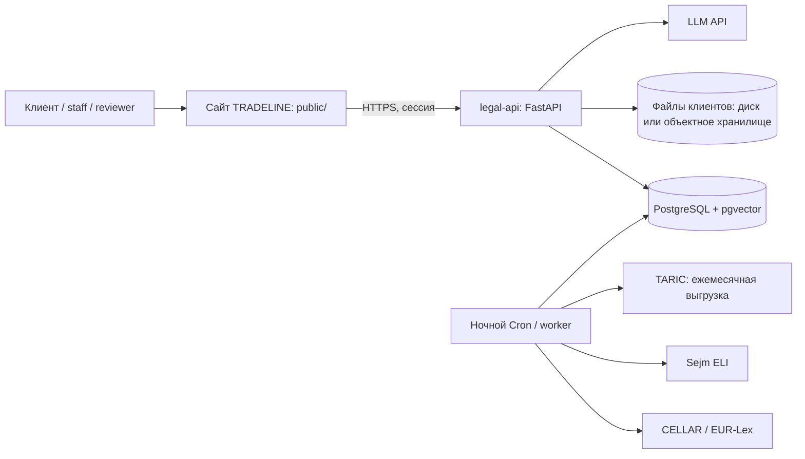
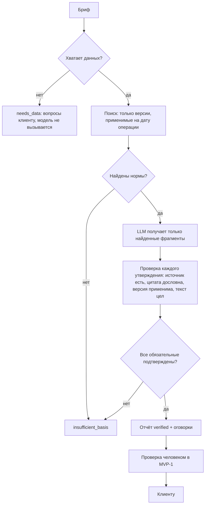

# 02. Архитектура

## 1. Принцип размещения
Текущий сайт (статический, `public/`) остаётся. К нему добавляется сервер `legal-api` и база PostgreSQL. Сайт обращается к серверу по адресу из `public/config.js` (`legalApi`). Пока адрес пустой, сайт работает в режиме «заявка специалистам» (этап 0).

## 2. Шесть компонентов и где они в коде
| Компонент | Реализация | Статус |
|---|---|---|
| Official Knowledge Base | `db/schema.sql`, `sources/registry.json`, `ingest/` | схема и разбор Sejm ELI написаны и частично протестированы; загрузка не запускалась |
| Legal Monitoring Engine | Cron + таблица `job`, `change_event` | спроектирован (03) |
| Legal Research Engine | `app/retrieval.py` (эталонный поиск по статьям), позже PostgreSQL FTS и pgvector | эталон протестирован |
| AI Reasoning Engine | `app/llm.py` (жёсткий промпт, только переданные фрагменты) | написан, не запускался |
| Verification Engine | `app/verification.py`, `app/timemachine.py` | протестирован |
| Legal Report Generator | форма отчёта в `verify_report`, PDF/DOCX позже | базовая форма готова |

## 3. Путь одного запроса

Источник в ответе (название, URL, дата, контрольная сумма) берётся из базы, а не из текста модели.

## 4. Расширяемость на юрисдикции и языки
- Идентификатор акта: `<источник>:<ключ>` (`eurlex:32026R0382`, `sejm:DU/2020/1`). Новая страна = новая запись в реестре + загрузчик, схема не меняется.
- Каждая версия хранится на языке оригинала; перевод только для показа и с пометкой.
- Поле `jurisdiction` и фильтр в поиске; для Китая и других юрисдикций сначала проверяется доступность и лицензия официальных источников (запись в реестре со статусом `to_verify`).

## 5. Решения по технологии
| Выбор | Почему | Альтернатива |
|---|---|---|
| Python + FastAPI | Уже есть код ядра на Python (stdlib) | Node |
| PostgreSQL (+ pgvector позже) | Одна база для данных, поиска и версий; RLS для изоляции | Отдельная векторная БД: лишние расходы |
| Cron + таблица `job` | Достаточно для ночных загрузок и обработки файлов | Redis + Celery: усложнение без пользы на старте |
| Хостинг Render, регион ЕС | Тот же стек, что для сайта | другой ЕС-хостинг |
| LLM по API с оплатой за использование | Не обучать модель с нуля | локальная модель: дорого и слабее |
